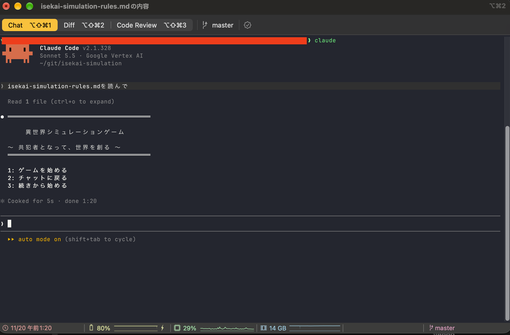

# 異世界シミュレーションゲーム

〜 共犯者となって、世界を創る 〜

Claude と一緒に仮想世界を作って観察する、テキストベースのシミュレーションゲームです。
ルールをまとめた Markdown ファイル `isekai-simulation-rules.md` を Claude に読み込ませるだけで遊べます。

## ゲームモード

初期設定でどちらかを選びます。

- **謎解きシミュレーション**: 暗号を基に、仮想世界の住人が謎を解き、我々にコンタクトを取れるかを検証します。主人公の家系を追い続けます。
- **歴史シミュレーション**: 設定した世界で、人類がどのように進化していくのかを検証します。世界の寿命を迎えるとゲーム終了です。

どちらのモードでも、Claude が住人に都合のよい誘導をすることはありません。選択の結果はランダムに決まります。

## 遊び方

1. このリポジトリを clone するか、`isekai-simulation-rules.md` をダウンロードします。
2. Claude(Claude Code など、ファイルを読み込める環境)で、このファイルがある場所を開きます。
3. Claude に次のように伝えます。

   ```
   isekai-simulation-rules.md を読み込んで
   ```

4. タイトル画面が表示されます。あとは画面の案内に従って初期設定を進めてください。

   

セーブとセーブデータからの再開にも対応しています。セーブデータは `saves/` フォルダに保存されます。このフォルダは Git の管理対象外です。

## ファイル構成

| ファイル | 内容 |
| --- | --- |
| `isekai-simulation-rules.md` | ゲームのルール本体(基本ルール、Claude の進行ルール、禁止事項など) |
| `images/` | README 用のスクリーンショット |

## ライセンス

[CC BY 4.0](https://creativecommons.org/licenses/by/4.0/deed.ja)(クリエイティブ・コモンズ 表示 4.0 国際)です。
自由に使用・改変・再配布できます。利用する際は、次のようにクレジットを表示してください。

> 異世界シミュレーションゲーム by [yusuke0511](https://github.com/yusuke0511) / [CC BY 4.0](https://creativecommons.org/licenses/by/4.0/deed.ja)

詳しくは [LICENSE](LICENSE) を参照してください。

ライセンスの正式な条文は英語版です。日本語での解説は [こちら](https://creativecommons.org/licenses/by/4.0/deed.ja) を参照してください。
